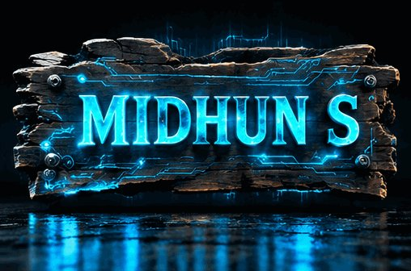
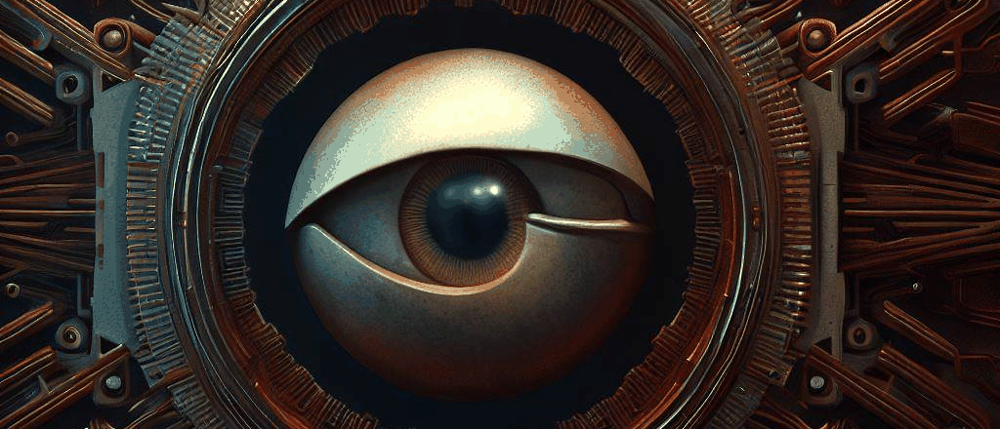
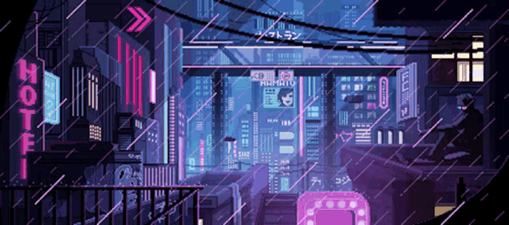

<div align="center">
  <!-- Wooden Board Neon Logo -->
  

  <br>

  <!-- High-Contrast Vibrant Orange Typing Animation (Optimized for both White & Black themes) -->
  <a href="https://git.io/typing-svg">
    
  </a>

  <br><br>

  <!-- Live Telemetry Status Badges -->
  <p align="center">
    
    
    
    
  </p>
</div>

<br>

<!-- SECTION 1: IDENTITY PROTOCOL + CYBERPUNK HOLOGRAM -->
<table>
<tr>
<td width="60%" valign="top">

### `> SYSTEM.EXECUTE // IDENTITY_CONFIG`

```ini
[OPERATOR]
Name           = Midhun S
Callsign       = AI / ML Systems Engineer & Full-Stack Architect
Core Directive = Bridge Deep Learning Research with High-Throughput Production
Inference Mode = Low Latency · Zero Hallucination · Fault Tolerant

[CURRENT_DEPLOYMENT]
Pipeline       = Enterprise Hybrid RAG with Vector Access Control (RBAC)
Streaming      = Dual-Tier Feature Store (Kafka ➔ Spark ➔ Redis)
Security_Lab   = CTF Pwn · Web Exploitation · OSINT · Race Conditions

[OBJECTIVE]
Seeking High-Impact Senior / Staff AI Systems & MLOps Engineering Roles
```

#### `> SECURE TRANSMISSION LINES:`
<p align="left">
  <a href="https://linkedin.com/in/midhunsomu" target="_blank"></a>
  <a href="https://github.com/midhunsomu" target="_blank"></a>
  <a href="https://discord.com/users/midhunsomu" target="_blank"></a>
  <a href="mailto:midhunsomu@example.com" target="_blank"></a>
  <a href="https://tryhackme.com/p/midhunsomu" target="_blank"></a>
</p>

</td>

<td width="40%" align="center" valign="middle">
  
  <br><br>
  <code>[STATUS: SYNAPSE_LINK_ACTIVE]</code>
</td>
</tr>
</table>

---

### `> NEURAL_ARCHITECTURE: torch.nn.Module // MidhunS_v2`

```python
import torch
import torch.nn as nn
from typing import Dict, Any

class MidhunS(nn.Module):
    """
    Production-Grade AI/ML Engineer Architecture.
    Optimized for high-throughput inference, vector search, and automated MLOps.
    """
    def __init__(self, clearance_level: str = "Root"):
        super(MidhunS, self).__init__()
        self.operator = "Midhun S"
        self.clearance = clearance_level
        
        # Core Neural Layers & Capabilities
        self.perception_layer = nn.TransformerEncoder(
            layers=["PyTorch", "HuggingFace", "SentenceTransformers", "FinBERT"],
            hidden_dim=4096
        )
        self.vector_retrieval_head = nn.CosineSimilarityIndex(
            stores=["ChromaDB", "Weaviate", "Qdrant", "RedisVector"],
            enforce_rbac=True
        )
        self.mlops_pipeline = nn.Sequential(
            nn.StreamingQueue("Apache Kafka"),
            nn.FeatureProcessing("Spark Streaming"),
            nn.Monitoring("Evidently AI Drift Detection"),
            nn.Orchestration(["Apache Airflow", "Kubernetes", "Docker", "MLflow"])
        )
        self.offense_defense_module = {
            "CTF_focus": ["Web Exploits", "Race Conditions", "Cryptanalysis", "OSINT"],
            "hardening": "Zero-Trust Retrieval & Guardrails"
        }

    def forward(self, problem: Dict[str, Any]) -> Dict[str, Any]:
        """Processes high-dimensional problem spaces into resilient scalable software."""
        context = self.vector_retrieval_head(problem["query"])
        solution = self.perception_layer(context)
        return self.mlops_pipeline.deploy(solution, target="Production-Cluster")

# Model Instantiation
model = MidhunS(clearance_level="Root")
print(model)
```

<br>

<!-- TECH MATRIX DUAL COLUMNS -->
<table>
<tr>
<td width="65%" valign="top">

#### `> PRODUCTION TECH MATRIX`
<p align="left">
  <b>Deep Learning & LLM Systems</b><br>
  
  
  
  
  
  
  <br><br>
  <b>Vector Search & Storage</b><br>
  
  
  
  
  <br><br>
  <b>MLOps & Distributed Infrastructure</b><br>
  
  
  
  
  
  
</p>

</td>

<td width="35%" align="center" valign="middle">
  
  <br><br>
  <code>[GPU_UTIL: 99.4% · TENSOR_CORES: ON]</code>
</td>
</tr>
</table>

---

### `> BENCHMARK // FEATURED PRODUCTION ARCHITECTURES`

<table>
<tr>
<th align="left">Repository / System</th>
<th align="left">Engineering Blueprint & Key Metric</th>
<th align="left">Telemetry Stack</th>
</tr>

<tr>
<td>
<b><a href="https://github.com/midhunsomu/Airflow_LLM_RAG_Finance">Airflow_LLM_RAG_Finance</a></b><br>
<sub>Streaming Financial RAG DAG</sub>
</td>
<td>
Continuous real-time ticker stream ingestor. Uses FinBERT domain embeddings into Weaviate vector spaces with GPT-4 contextual re-ranking for sub-second financial analysis.
</td>
<td>


</td>
</tr>

<tr>
<td>
<b><a href="https://github.com/midhunsomu/ModelForge">ModelForge</a></b><br>
<sub>Autonomous Drift & Canary MLOps</sub>
</td>
<td>
Automated data/concept drift trigger engine using Evidently. Automatically spawns shadow canary deploys and triggers zero-downtime retraining pipelines over Kafka queues.
</td>
<td>


</td>
</tr>

<tr>
<td>
<b><a href="https://github.com/midhunsomu/Feature_Store">Feature_Store</a></b><br>
<sub>Low-Latency Dual-Tier Store</sub>
</td>
<td>
Dual-engine streaming feature store: in-memory Redis cluster for ultra-low latency (<10ms) online inference and analytical lakehouse for historical backfills.
</td>
<td>


</td>
</tr>
</table>

<details>
<summary><b>Expand Engineering Manifesto & System Design Heuristics</b></summary>
<br>
<blockquote>
1. <b>Rule #1:</b> <i>Data Quality > Parameter Count.</i> A well-chunked, hygienically-indexed RAG vector store outstrips uncurated trillion-token pretraining every single time.<br>
2. <b>Rule #2:</b> <i>Security is an Architectural Primitive.</i> RBAC, vector filtering, and guardrails must live in the retrieval logic, not as fragile prompt-level patches.<br>
3. <b>Rule #3:</b> <i>If It Isn't Monitored, It Isn't in Production.</i> Real-time tracking of embedding drift, P99 token latency, and hallucination rates are mission-critical.
</blockquote>
</details>

---

### `> NEURAL_VISION // TELEMETRY DASHBOARD`

<div align="center">
  <!-- Mechanical Cyber Eye Banner Centered on the Eye -->
  
</div>

<!-- Perfectly Aligned Light Theme Automated Stats Grid -->
<table align="center" width="100%">
<tr>
<td width="50%" align="center" valign="middle">
  
</td>
<td width="50%" align="center" valign="middle">
  
</td>
</tr>
<tr>
<td colspan="2" align="center" valign="middle">
  
</td>
</tr>
</table>

---

<div align="center">
  <i>"Building systems that scale, learn, and secure the future."</i><br><br>
  <!-- Tenor footer animation -->
  
</div>
